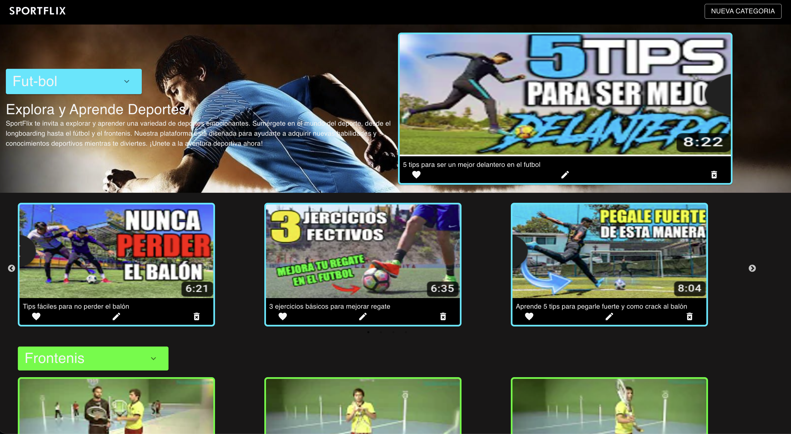
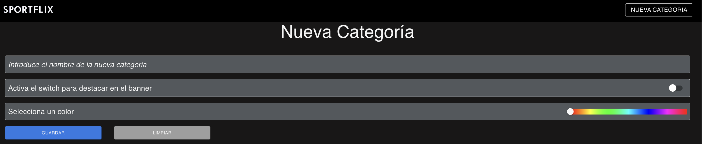
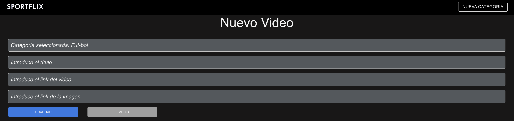

# Sportflix

Aplicación web para la gestión y organización de videos mediante categorías. Permite crear, consultar, editar y eliminar categorías y videos, utilizando una interfaz desarrollada con React y una API REST como fuente de datos.

## Características

- **Gestión de categorías:** creación, consulta, edición y eliminación de categorías.
- **Gestión de videos:** registro de videos asociados a categorías, edición de su información y eliminación.
- **Navegación dinámica:** navegación entre las distintas vistas mediante rutas y parámetros de URL.
- **Gestión de datos y estado:** uso de Redux Toolkit para centralizar los datos de categorías y videos, gestionar operaciones asíncronas y actualizar el estado de la aplicación tras las operaciones CRUD.
- **Integración con API REST:** comunicación con el backend para consultar y persistir los datos.
- **Interfaz de usuario:** componentes reutilizables, formularios y elementos visuales para organizar y presentar el contenido.

## Capturas de pantalla


### Página principal de Sportflix


### Formulario de categoría


### Formulario de videos


## Tecnologías

### Frontend

- **React 18:** desarrollo de la interfaz mediante componentes.
- **React Router DOM:** navegación y configuración de rutas.
- **Redux Toolkit:** gestión del estado de la aplicación y coordinación de operaciones asíncronas.
- **React Redux:** integración de Redux con los componentes de React.
- **Reselect:** creación de selectores para obtener datos derivados del estado.
- **Axios:** comunicación HTTP con el backend.
- **Material UI:** componentes y herramientas para la interfaz.
- **CSS y Styled Components:** estilos y presentación de los componentes.
- **Create React App:** configuración del entorno de desarrollo y construcción de la aplicación.

### Backend

El frontend consume una API REST desarrollada independientemente con:

- Python
- Flask
- MySQL

El backend se encuentra en un repositorio separado: [AluraFlix Backend](https://github.com/davecarrillo/aluraflix-backend).

## Organización del proyecto

El código fuente está organizado por funcionalidades y responsabilidades:

```text
src/
├── Components/       # Componentes reutilizables de interfaz
├── api/              # Configuración y funciones de comunicación HTTP
├── features/
│   ├── categories/   # Estado y operaciones de categorías
│   ├── videos/       # Estado y operaciones de videos
│   └── feedbackdialog/
│                     # Gestión de mensajes y diálogos de feedback
├── pages/            # Vistas y configuración de rutas
├── store/            # Configuración del store de Redux
├── App.js
└── index.js
```

Esta organización permite localizar las distintas funcionalidades y mantener separadas las vistas, los componentes de interfaz, la comunicación con la API y la gestión del estado.

## Requisitos

Para ejecutar el proyecto necesitas:

- Node.js y npm.
- El backend de Sportflix en funcionamiento.
- Una instancia de MySQL configurada para el backend.

## Instalación y ejecución

### 1. Clonar el repositorio

```bash
git clone https://github.com/BetoCarr/Sportflix.git
cd Sportflix
```

### 2. Instalar dependencias

```bash
npm install
```

### 3. Configurar el backend

Clona y configura el [repositorio del backend](https://github.com/davecarrillo/aluraflix-backend), siguiendo sus instrucciones de instalación y configuración de la base de datos.

El frontend está configurado para comunicarse con el backend en:

```text
http://localhost:5050
```

Si utilizas otra dirección o puerto, actualiza la propiedad `baseURL` en `src/api/api.js`.

### 4. Iniciar la aplicación

```bash
npm start
```

La aplicación estará disponible, por defecto, en:

```text
http://localhost:3000
```

## Scripts disponibles

| Comando | Descripción |
|---|---|
| `npm start` | Inicia el servidor de desarrollo. |
| `npm run build` | Genera la versión optimizada para producción. |
| `npm test` | Ejecuta el entorno de pruebas de Create React App. |

## Pruebas

La rama principal (`main`) no incluye actualmente una suite de pruebas automatizadas.

Existe una rama independiente (`test`) que conserva trabajo exploratorio relacionado con pruebas de componentes y lógica de estado. Durante ese proceso se identificaron dificultades de acoplamiento y aislamiento de responsabilidades, por lo que esos cambios no se integraron en la versión principal.

La versión de `main` ha sido verificada mediante la ejecución de la aplicación y pruebas manuales de las operaciones principales, incluyendo la persistencia de los cambios al recargar la aplicación.

## Estado del proyecto

Sportflix integra una aplicación React con un backend independiente basado en Flask y MySQL.

El proyecto reúne experiencia práctica en desarrollo de interfaces con componentes, formularios, enrutamiento, gestión de estado, operaciones asíncronas e integración con servicios REST.